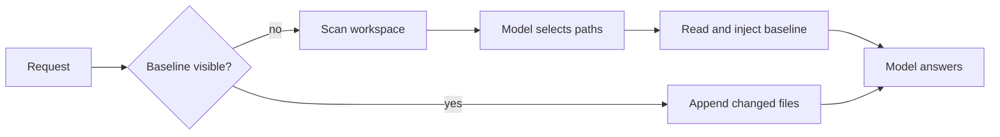

# Prefill Agentic

English | [中文](README.zh.md)

[](LICENSE) [](docs/development.md) [](https://github.com/deepseek-ai/deepseek-harness) [](https://github.com/gopinath87607/prefill-agentic/pulls)

Prefill Agentic is a fork of [DeepSeek Harness](https://github.com/deepseek-ai/deepseek-harness) for long-context engines. It puts the repository in context before the model answers: one model-chosen snapshot of the workspace opens the conversation as a durable, cacheable baseline, and every later turn appends only the files that changed.

## Why prefill

An agent that starts from an empty context spends its first turns searching, reading, and reading again. Every tool call costs latency and tokens, and the cost repeats in each new session. Prefill reverses the order: the files that can answer the request are already in context when the first request is sent, and the conversation grows through small append-only updates.

The baseline is chosen by a model, not by directory position. The harness scans the workspace, lists the candidates with their sizes, and asks one auxiliary model call which paths matter for this request. The model returns paths with a short reason for each; the harness validates the answer and reads only the chosen files. When the call cannot produce a usable answer, deterministic shallow-first order keeps prefill working.

## Highlights

- **Model-chosen baseline.** One auxiliary call picks the relevant paths from a bounded candidate list and records a reason for every file.
- **Cacheable prefix.** The baseline is written once and never rewritten; later turns append deltas, so the engine can reuse the cached prompt.
- **Durable by construction.** Snapshot messages and selection calls are session events: resume rebuilds them, replay reproduces them, and compaction replaces them like any other message.
- **Bounded work.** Token budgets, file caps, depth and entry limits, gitignore-aware scanning, and credential-like exclusions keep every scan predictable.
- **Safe fallback.** A timeout, a missing route, or an unusable answer falls back to deterministic shallow-first order with a recorded reason.
- **Visible payoff.** The dashboard reports prefilled files, selection reasons, cache hit, token buckets, net saved tokens, and estimated time saved.

<a id="run"></a><a id="run-from-source"></a>

## Quick start

Requires Node.js 24.9 or newer and pnpm. Build the checkout once:

```sh
pnpm install
pnpm run build
```

### Linux

```sh
export MAYA_BASE_URL=http://127.0.0.1:8080/v1
export MAYA_MODEL=deepseek-v4.1-flash
export MAYA_API_KEY=<key>
export DSH_PROVIDER=maya
export DSH_MODEL="$MAYA_MODEL"
node apps/cli/lib/bin.js --profile web \
  --patch engines.patch.yml \
  --patch prefill.patch.yml \
  --port 3080
```

The Web UI listens on `http://127.0.0.1:3080` and prints a token URL. A VirtualBox guest reaches it at `http://10.0.2.2:3080`; add `--trusted-host 10.0.2.2:3080` so the server accepts that host header.

### Windows VM

The Windows checkout uses two PowerShell scripts. Run the first once from an elevated window, then start the harness from a normal window:

```powershell
powershell -ExecutionPolicy Bypass -File "\\vboxsvr\NVMe-Share\dsh-windows\setup-dsh.ps1"
```

```powershell
powershell -ExecutionPolicy Bypass -File C:\dsh-tools\start-dsh.ps1
```

Setup installs Node 24, Git, and pnpm when they are missing, enables Developer Mode and long paths for pnpm's symlinks, clones this fork to `C:\dsh`, and builds the artifacts. The launcher sets the engine environment for `http://10.0.2.2:8080`, starts the Web UI on port 3080, and opens the browser. Pass `-Port <port>` or `-Workspace <path>` to change the defaults; the default workspace is `Documents\deepseek-harness`.

## How it works



A session with no visible baseline scans its working directory once, before the first eligible step. Scanning honors `.gitignore`, excluded directories and names, extension and filename rules, depth and count limits, and skips files that look like credentials or generated output. The result is a bounded list of candidate paths with their byte sizes.

The selection call receives the step's request text and that list, both bounded by `selectorInputTokens`. The harness drops unknown, repeated, malformed, and over-cap entries from the answer, then reads the chosen files in the model's priority order until `budgetTokens` is full. Chosen paths that do not fit the budget, and paths skipped by a cap, are named in the path index when `includePathIndex` is enabled.

The baseline is committed as one user message and is never rewritten. Every later turn rescans, compares versions and digests, and appends a delta with added, modified, and removed paths, capped by `deltaBudgetTokens`. Because the earlier request prefix stays untouched, the engine can serve it from its KV cache while it processes only the new tail.

A compaction that shadows the baseline clears the visible snapshot, and the next step rebuilds it: the selector runs again on the new request and the dashboard shows the new selection. A working-directory change rebuilds it in the same way.

## The model chooses the files

The selector answers `{"files":[{"path","reason"}]}` using only paths from the listed candidates. The manifest is bounded, so the model can choose only from what the scan found, and the request text can use at most half of `selectorInputTokens`; a workspace too large for the budget exposes its shallower paths first.

```json
{"files":[{"path":"packages/core/session/src/surface.ts","reason":"the request changes session persistence"}]}
```

The call is logged, not shown. `prefill/selection-request` records the exact instruction, messages, output cap, and manifest counters before dispatch; `prefill/selection` records the outcome with the route, duration, usage, raw blocks, and the replay marker. Neither message enters the conversation surface, so the visible answer stays clean and replay can rebuild the auxiliary stream.

The route is the configured `selectorProvider`/`selectorModel` pair when both are set, otherwise the provider and model captured for the step. Any failure falls back to the deterministic baseline in the same step and records one of `no-candidates`, `no-request`, `llm-unavailable`, `no-route`, `timeout`, `stream-error`, or `invalid-response`. Set `selection: deterministic` to skip the call entirely; an empty model answer is respected and commits an empty baseline, after which delta turns append untracked files shallowest-first within `deltaBudgetTokens`.

## The dashboard

The Web UI ships a Prefill dashboard as a page on the right sidebar; open the guide page and choose **Prefill dashboard**. Every figure comes from host-computed session projections, so the page reports what the harness recorded rather than an estimate rebuilt in the browser.

- **Prefill**: files in the visible snapshot, visible prefill tokens, every prefill token the session introduced, provider-reported cached prompt tokens, selection calls and their tokens, net tokens saved, and estimated time saved.
- **Latest selection**: `Model` or `Deterministic`, the provider and model, chosen and dropped counts, duration, tokens, and the fallback reason with its diagnostic.
- **Cache and tokens**: uncached input, cached input, cache write, and output buckets for the session and the newest request, with the prompt total and cache-hit ratio.
- **Context**: the next request's projected prompt against the newest advertised context window.

Saved tokens are `max(0, reusedTokens - injectedTokens - selectorTokens)`: cache reads credited to the prefill prefix, minus what prefill and selection added. Saved time divides that figure by `promptTokensPerSecond`, the measured uncached prompt rate of the engine.

## Configuration

Enable the plugin in `prefill.patch.yml`; the launcher reads it at startup:

```yaml
- id: prefill-context
  name: '@deepseek-ai/dsh-prefill-context'
  disabled: false
  config:
    budgetTokens: 400000
    deltaBudgetTokens: 16000
    charsPerToken: 3.4
    maxFileTokens: 32000
    includePathIndex: true
    indexBudgetTokens: 8000
    respectGitignore: true
    position: before
    agents: main
    guidance: true
    promptTokensPerSecond: 1000
```

| Setting | Overlay | Default | What it does |
| --- | --- | --- | --- |
| `budgetTokens` | 400000 | 150000 | Token budget for the first snapshot; the header reserve is subtracted. |
| `deltaBudgetTokens` | 16000 | 32000 | Changed content appended in one later turn. |
| `charsPerToken` | 3.4 | 4 | Characters per token for every budget decision. |
| `maxFileTokens` | 32000 | 32000 | Skips one oversized file instead of filling the budget with it. |
| `indexBudgetTokens` | 8000 | 4000 | Extra budget naming skipped paths for the read tool. |
| `selection` | model | model | `model` chooses paths; `deterministic` keeps shallow-first order. |
| `selectorInputTokens` | — | 16000 | Request text plus candidate manifest budget. |
| `selectorMaxFiles` | — | 64 | Maximum paths one answer may choose. |
| `selectorTimeoutMs` | — | 30000 | End-to-end deadline for the selection call. |
| `respectGitignore` | true | true | Applies each directory's `.gitignore` while scanning. |
| `position` | before | after | Keeps the newest user message last in the request. |
| `agents` | main | all | Keeps the large baseline out of subagent sessions. |
| `guidance` | true | true | Registers the system-prompt paragraph that tells the model to reuse the snapshot. |

`promptTokensPerSecond` converts cached prefill tokens into saved time and should describe the deployment engine; the overlay uses the measured ~1,000 tokens per second of the local Maya server. `selectorProvider` and `selectorModel` must be set together and default to the step's own route. The package README documents every remaining cap, include rule, exclusion, and refresh mode.

Keep the baseline below the compaction trigger. On a 1M-token engine, 400,000 tokens leaves room for the verbatim tail and the conversation; a snapshot close to the model window is replaced by compaction, which ends the cache reuse. With the measured Maya tokenizer at 3.4 characters per token, the cold 400k-token baseline costs roughly seven minutes once per unchanged prefix.

## Engines

`engines.patch.yml` adds two providers and selects the default route from the environment:

```sh
export MAYA_BASE_URL=https://engine.example/v1
export MAYA_MODEL=<served model id>
export MAYA_API_KEY=<key>
export SATARATA_BASE_URL=https://engine.example/v1
export SATARATA_MODEL=<served model id>
export SATARATA_API_KEY=<key>
export DSH_PROVIDER=maya
export DSH_MODEL="$MAYA_MODEL"
```

Both providers speak OpenAI Chat Completions by default. Set `MAYA_API` or `SATARATA_API` to `openai-responses` or `anthropic-messages` for another protocol. A large cold prefill can keep the engine busy for minutes before the first stream chunk, so both routes default to a 20-minute idle timeout; override it with `MAYA_STREAM_IDLE_MS` or `SATARATA_STREAM_IDLE_MS`. Credentials stay in the launch environment: no key or deployment URL is committed.

## Automatic continuation

The Web `standard` preset mounts the goal tools, and the base bundle loads the goal round driver. A model-created goal continues by itself until it completes, is paused, or reaches its round cap; the goal service default is 256 rounds. The prefill plugin never starts a turn; it only adds snapshot messages to steps the model already takes, so an agent that keeps working after finishing its answer is usually an active goal or an ordinary tool-call chain, not the snapshot. `repeat-tool-reminder` only warns at repeated calls and never blocks.

Inspect the current goal with `/goal`, then stop it with `/goal pause` or `/goal clear`. To bound every goal in a profile, set the default cap on the goal row:

```yaml
- id: goal
  name: '@deepseek-ai/dsh-goal'
  config:
    defaultMaxGoalRounds: 5
```

To switch automatic goal rounds off while keeping goals trackable, disable the driver row:

```yaml
- id: goal-round-driver
  name: '@deepseek-ai/dsh-goal-round-driver'
  disabled: true
```

## Windows and shared folders

The Windows file writer preserves NTFS security descriptors and publishes through hard links. VirtualBox shared folders implement neither operation, so a Windows harness should edit a local NTFS folder. The shared folder still works for reading and for the prefill scan, and the Linux harness can edit it directly.

## Documentation

- [Prefill context](packages/context/prefill-context/README.md): the selection contract, the full configuration table, and the accounting rules.
- [Prefill dashboard](packages/client/ui-prefill/README.md): the sidebar page, its projections, and how to read each number.
- [Architecture](docs/architecture.md): how the harness composes plugins and sessions.
- [Upstream documentation](https://deepseek-harness.github.io/deepseek-harness/): the harness this fork tracks.

## Contributing

DeepSeek Harness is in developer preview and changes quickly; this fork tracks its `master` and keeps the upstream license. Read the [safety notice](https://github.com/deepseek-ai/deepseek-harness/blob/master/SAFETY.md) before running the harness, and follow the [upstream contributing guide](https://github.com/deepseek-ai/deepseek-harness/blob/master/CONTRIBUTING.md) before changing code. Anyone who reuses a commit from this fork must credit [gopinath87607/prefill-agentic](https://github.com/gopinath87607/prefill-agentic).

## License

[MIT](LICENSE)
