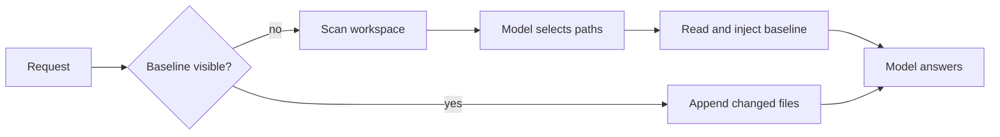

# Prefill Agentic

[English](README.md) | 中文

[](LICENSE) [](docs/development.zh.md) [](https://github.com/deepseek-ai/deepseek-harness) [](https://github.com/gopinath87607/prefill-agentic/pulls)

Prefill Agentic 是面向长上下文引擎的 [DeepSeek Harness](https://github.com/deepseek-ai/deepseek-harness) 分支。它在模型回答之前把仓库放进上下文：一条由模型选择的工作区快照作为对话开头，成为持久、可缓存的基线，之后每一轮只追加发生变化的文件。

## 为什么需要预填充

从空上下文开始的代理会把最初的轮次花在搜索、读取和再次读取上。每次工具调用都消耗延迟和 token，而且每个新会话都会重复这笔开销。预填充把顺序反过来：能够回答请求的文件在首次请求发出时就已经在上下文中，对话之后通过小而只追加的更新增长。

基线由模型选择，而不是按目录位置选择。harness 扫描工作区，列出候选文件及其大小，然后通过一次辅助模型调用询问哪些路径与本次请求相关。模型返回路径以及每个文件的简短理由；harness 校验答案并只读取被选中的文件。当调用无法给出可用答案时，确定性的最浅优先顺序会让预填充继续工作。

## 亮点

- **由模型选择基线。** 一次辅助调用从有界的候选清单中选出相关路径，并为每个文件记录理由。
- **可缓存的前缀。** 基线只写入一次，之后从不重写；后续轮次只追加增量，因此引擎可以复用已缓存的提示。
- **持久可重建。** 快照消息与选择调用都是会话事件：恢复会重建它们，重放会复现它们，压缩会像处理其他消息一样替换它们。
- **工作量有界。** token 预算、文件上限、深度与条目限制、遵循 `.gitignore` 的扫描，以及类凭据排除，让每次扫描都可预测。
- **安全回退。** 超时、缺少路由或不可用答案都会回退到确定性的最浅优先顺序，并记录原因。
- **收益可见。** 仪表盘报告已预填充的文件、选择理由、缓存命中、token 分桶、净节省 token 与预计节省时间。

<a id="run"></a><a id="run-from-source"></a>

## 快速开始

需要 Node.js 24.9 或更新版本以及 pnpm。先构建一次检出目录：

```sh
pnpm install
pnpm run build
```

### Linux

```sh
export MAYA_BASE_URL=http://127.0.0.1:8080/v1
export MAYA_MODEL=deepseek-v4.1-flash
export MAYA_API_KEY=<key>
export DSH_PROVIDER=maya
export DSH_MODEL="$MAYA_MODEL"
node apps/cli/lib/bin.js --profile web \
  --patch engines.patch.yml \
  --patch prefill.patch.yml \
  --port 3080
```

Web UI 监听 `http://127.0.0.1:3080` 并打印一个带 token 的 URL。VirtualBox 客户机可通过 `http://10.0.2.2:3080` 访问；添加 `--trusted-host 10.0.2.2:3080`，服务器才会接受该 Host 头。

### Windows 虚拟机

Windows 检出目录使用两个 PowerShell 脚本。第一次从管理员窗口运行安装脚本，然后从普通窗口启动 harness：

```powershell
powershell -ExecutionPolicy Bypass -File "\\vboxsvr\NVMe-Share\dsh-windows\setup-dsh.ps1"
```

```powershell
powershell -ExecutionPolicy Bypass -File C:\dsh-tools\start-dsh.ps1
```

安装脚本会在缺失时安装 Node 24、Git 和 pnpm，为 pnpm 的符号链接启用 Developer Mode 和长路径，把本分支克隆到 `C:\dsh` 并构建产物。启动脚本设置指向 `http://10.0.2.2:8080` 的引擎环境，在 3080 端口启动 Web UI 并打开浏览器。用 `-Port <port>` 或 `-Workspace <path>` 更改默认值；默认工作区是 `Documents\deepseek-harness`。

## 工作方式



没有可见基线的会话会在第一个符合条件的步骤之前扫描一次工作目录。扫描遵循 `.gitignore`、排除目录与文件名、扩展名与文件名包含规则、深度与数量限制，并跳过类似凭据或生成产物的文件。结果是带字节大小的有界候选路径清单。

选择调用接收该步骤的请求文本和该清单，两者都受 `selectorInputTokens` 限制。harness 会丢弃答案中未知、重复、格式错误和超出上限的条目，然后按模型的优先顺序读取被选中的文件，直到 `budgetTokens` 用满。被选中但放不进预算的路径，以及因上限被跳过的路径，会在启用 `includePathIndex` 时列入路径索引。

基线作为一条用户消息提交，之后从不重写。后续每一轮都会重新扫描，比较版本与摘要，并追加一条包含新增、修改和删除路径的增量，受 `deltaBudgetTokens` 限制。由于较早的请求前缀保持不变，引擎可以从 KV Cache 提供它，只处理新的尾部。

遮蔽基线的压缩会清除可见快照，下一步会重建它：选择器针对新请求再次运行，仪表盘显示新的选择。工作目录变化也会以同样方式重建基线。

## 模型选择文件

选择器必须只使用清单中的候选路径回答 `{"files":[{"path","reason"}]}`。清单是有界的，因此模型只能从扫描结果中选择；请求文本最多占用 `selectorInputTokens` 的一半，工作区过大时只会暴露较浅的路径。

```json
{"files":[{"path":"packages/core/session/src/surface.ts","reason":"the request changes session persistence"}]}
```

调用只写入日志，不会显示。`prefill/selection-request` 在派发前记录确切的系统指令、消息、输出上限与清单计数；`prefill/selection` 记录结果、路由、耗时、用量、原始块与重放标记。两条消息都不会进入对话界面，因此可见回答保持干净，重放也能重建辅助流。

当 `selectorProvider`/`selectorModel` 同时配置时使用该路由，否则使用该步骤捕获的提供方与模型。任何失败都会在同一步回退到确定性基线，并记录 `no-candidates`、`no-request`、`llm-unavailable`、`no-route`、`timeout`、`stream-error` 或 `invalid-response` 之一。设置 `selection: deterministic` 可完全跳过该调用；空答案会被尊重并提交空基线，之后增量轮次会在 `deltaBudgetTokens` 范围内按最浅优先追加未跟踪文件。

## 仪表盘

Web UI 在右侧边栏提供 Prefill 仪表盘页面；打开指南页并选择 **Prefill dashboard** 即可。所有数字都来自宿主计算的会话投影，因此页面报告的是 harness 记录的内容，而不是浏览器重建的估计值。

- **预填充**：可见快照中的文件数、当前可见的预填充 token、会话引入的全部预填充 token、提供方报告的缓存提示 token、选择调用及其 token、净节省 token 与预计节省时间。
- **最近一次选择**：`Model` 或 `Deterministic`、提供方与模型、选中与丢弃计数、耗时、token，以及回退原因与诊断。
- **缓存与 token**：会话与最新请求的未缓存输入、缓存输入、缓存写入和输出分桶，以及提示总量与缓存命中率。
- **上下文**：下一次请求的预计提示与最新公布的上下文窗口。

节省 token 为 `max(0, reusedTokens - injectedTokens - selectorTokens)`：计入预填充前缀的缓存读取减去预填充与选择调用新增的部分。节省时间用该数值除以 `promptTokensPerSecond`，即引擎实测的未缓存提示处理速率。

## 配置

在 `prefill.patch.yml` 中启用插件；启动器在启动时读取该文件：

```yaml
- id: prefill-context
  name: '@deepseek-ai/dsh-prefill-context'
  disabled: false
  config:
    budgetTokens: 400000
    deltaBudgetTokens: 16000
    charsPerToken: 3.4
    maxFileTokens: 32000
    includePathIndex: true
    indexBudgetTokens: 8000
    respectGitignore: true
    position: before
    agents: main
    guidance: true
    selectorTimeoutMs: 300000
    promptTokensPerSecond: 1000
```

| 设置 | 覆盖值 | 默认值 | 作用 |
| --- | --- | --- | --- |
| `budgetTokens` | 400000 | 150000 | 第一个快照的 token 预算；会减去头部保留量。 |
| `deltaBudgetTokens` | 16000 | 32000 | 后续单轮追加的变化内容。 |
| `charsPerToken` | 3.4 | 4 | 所有预算判断使用的每 token 字符数。 |
| `maxFileTokens` | 32000 | 32000 | 跳过单个过大的文件，而不是让它占满预算。 |
| `indexBudgetTokens` | 8000 | 4000 | 为读取工具列出被跳过路径的额外预算。 |
| `selection` | model | model | `model` 由模型选择路径；`deterministic` 保持最浅优先顺序。 |
| `selectorInputTokens` | — | 16000 | 请求文本与候选清单的预算。 |
| `selectorMaxFiles` | — | 64 | 单个答案最多可选择的路径数。 |
| `selectorTimeoutMs` | 300000 | 30000 | 选择调用的端到端截止时间。 |
| `respectGitignore` | true | true | 扫描时应用每个目录的 `.gitignore`。 |
| `position` | before | after | 让最新的用户消息保持在请求最后。 |
| `agents` | main | all | 避免把大基线放进子代理会话。 |
| `guidance` | true | true | 注册系统提示段落，要求模型复用快照。 |

`promptTokensPerSecond` 把缓存的预填充 token 换算为节省时间，应描述部署引擎；覆盖配置使用本地 Maya 服务器实测的约 1,000 token/s。选择器是同一引擎上的一次生成，因此覆盖配置把它的截止时间延长到五分钟；插件向路由请求其支持的最低推理级别，使该调用不会继承推理负担较重的默认值。`selectorProvider` 与 `selectorModel` 必须成对设置，默认使用该步骤自身的路由。包的 README 记录了其余上限、包含规则、排除项和刷新模式。

让基线保持在压缩触发点以下。在 1M token 的引擎上，400,000 token 为逐字尾部和对话留出空间；接近模型窗口的快照会被压缩替换，缓存复用也随之结束。按实测的 Maya 分词器每 token 3.4 个字符计算，400k token 的冷基线在每个未变化前缀上只需约七分钟。

## 引擎

`engines.patch.yml` 添加两个提供方，并从环境选择默认路由：

```sh
export MAYA_BASE_URL=https://engine.example/v1
export MAYA_MODEL=<served model id>
export MAYA_API_KEY=<key>
export SATARATA_BASE_URL=https://engine.example/v1
export SATARATA_MODEL=<served model id>
export SATARATA_API_KEY=<key>
export DSH_PROVIDER=maya
export DSH_MODEL="$MAYA_MODEL"
```

两个提供方默认使用 OpenAI Chat Completions 协议。其他协议可把 `MAYA_API` 或 `SATARATA_API` 设为 `openai-responses` 或 `anthropic-messages`。大量冷预填充可能让引擎在首个流式块之前忙碌数分钟，因此两条路由默认 20 分钟空闲超时；用 `MAYA_STREAM_IDLE_MS` 或 `SATARATA_STREAM_IDLE_MS` 覆盖。`MAYA_REASONING` 与 `SATARATA_REASONING` 设置路由的默认思考级别（默认 `high`）；未指定级别的调用沿用该默认值，而预填充选择器请求路由支持的最低级别（这里是 `off`）。凭据只存在于启动环境中：不会提交任何密钥或部署 URL。

## 自动续轮

Web 的 `standard` 预设挂载了 goal 工具，基础 bundle 又加载了 goal 轮次驱动器。模型创建的 goal 会自行继续，直到完成、暂停或达到轮次上限；goal 服务的默认上限是 256 轮。预填充插件从不发起轮次；它只向模型本来就会执行的步骤添加快照消息，所以回答完后仍在工作的代理通常对应一个活动 goal 或普通的工具调用链，而不是快照。`repeat-tool-reminder` 只在重复调用时提醒，从不阻止。

用 `/goal` 查看当前 goal，用 `/goal pause` 或 `/goal clear` 停止它。要限制 profile 中的每个 goal，在 goal 行设置默认上限：

```yaml
- id: goal
  name: '@deepseek-ai/dsh-goal'
  config:
    defaultMaxGoalRounds: 5
```

要在保留 goal 跟踪的同时关闭自动 goal 轮次，禁用驱动器行：

```yaml
- id: goal-round-driver
  name: '@deepseek-ai/dsh-goal-round-driver'
  disabled: true
```

## Windows 与共享文件夹

Windows 文件写入器会保留 NTFS 安全描述符并通过硬链接发布。VirtualBox 共享文件夹既不实现安全描述符写入，也不支持硬链接，因此 Windows harness 应编辑本地 NTFS 文件夹。共享文件夹仍可用于读取和预填充扫描，Linux harness 可以直接编辑它。

## 文档

- [预填充上下文](packages/context/prefill-context/README.zh.md)：选择契约、完整配置表与记账规则。
- [预填充仪表盘](packages/client/ui-prefill/README.zh.md)：侧边栏页面、其投影，以及如何阅读每个数字。
- [架构](docs/architecture.zh.md)：harness 如何组合插件与会话。
- [上游文档](https://deepseek-harness.github.io/deepseek-harness/)：本分支跟踪的 harness。

## 贡献

DeepSeek Harness 处于开发者预览阶段，变化很快；本分支跟踪其 `master` 并保留上游许可证。运行 harness 前请阅读[安全说明](https://github.com/deepseek-ai/deepseek-harness/blob/master/SAFETY.md)，修改代码前请遵循[上游贡献指南](https://github.com/deepseek-ai/deepseek-harness/blob/master/CONTRIBUTING.md)。任何复用本分支提交的人都必须注明 [gopinath87607/prefill-agentic](https://github.com/gopinath87607/prefill-agentic)。

## 许可证

[MIT](LICENSE)
